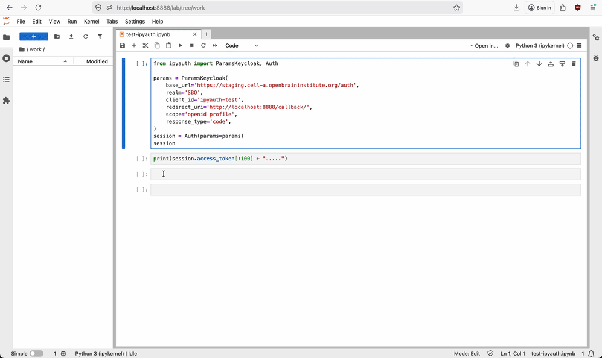

# ipyauth-pkce

A [Jupyter widget](https://ipywidgets.readthedocs.io/en/stable/) that lets notebook users authenticate via OAuth2 (Authorization Code with PKCE) directly from a notebook cell.

After signing in, the access token is available in the Python kernel for making requests to protected APIs.

## Demo



## Supported Providers

- Keycloak (fully tested with PKCE)
- Auth0
- Google

## Requirements

- Python >= 3.12
- JupyterLab >= 4.0
- ipywidgets >= 8.0, < 9

## Install

```bash
pip install ipyauth-pkce
```

The package installs both the Python widget and the JupyterLab extension automatically.

## Usage (Keycloak)

```python
from ipyauth_pkce import ParamsKeycloak, Auth

params = ParamsKeycloak(
    base_url='https://your-keycloak-server/auth',
    realm='your-realm',
    client_id='your-client-id',
    redirect_uri='http://localhost:8888/callback/',
    scope='openid profile',
)

session = Auth(params=params)
session  # displays the widget — click "Sign In"
```

`redirect_uri` must be your Jupyter server's URL followed by `/callback/`, and
it must be registered as an allowed redirect URI for the client at your
provider. The `scope` must include `openid` and `profile`. Values can also be
loaded from a dotenv file: `ParamsKeycloak(dotenv_folder='.',
dotenv_file='ipyauth-keycloak-myrealm.env')` (the file name must start with
`ipyauth-<provider>-` and end with `.env`); explicit arguments override it.

The widget tries to open the sign-in popup as soon as it is displayed; if the
browser blocks that, click "Sign In".

After authenticating:

```python
session.access_token       # the JWT access token
session.headers            # {'Authorization': 'Bearer eyJ...'}
session.is_authenticated   # True / False
session.logged_as          # user email or name
session.expires_at         # expiry timestamp

# Use with requests
import requests
r = requests.get('https://api.example.com/data', headers=session.headers)
```

### Other Providers

```python
from ipyauth_pkce import ParamsAuth0, Auth

params = ParamsAuth0(
    domain='your-tenant.auth0.com',
    client_id='your-client-id',
    redirect_uri='http://localhost:8888/callback/',
    scope='openid profile',
)
session = Auth(params=params)
```

```python
from ipyauth_pkce import ParamsGoogle, Auth

params = ParamsGoogle(
    client_id='your-client-id.apps.googleusercontent.com',
    redirect_uri='http://localhost:8888/callback/',
    scope='openid profile email',
)
session = Auth(params=params)
```

## How It Works

1. The widget opens a popup window pointing to the OAuth provider's authorization endpoint
2. The user authenticates in the popup
3. The provider redirects back to `/callback/` with an authorization code
4. The callback page sends the code back to the widget via `postMessage`
5. The widget asks the Jupyter server to exchange the code for tokens (PKCE: a public client, no client secret)
6. The widget validates the ID token, and the access token becomes available in the Python kernel

When the token expires the widget clears it; sign in again to get a new one (refresh tokens are not used).

## Security

- Authorization Code flow with PKCE (no implicit flow, no client secrets in the browser)
- Server-side token exchange via Jupyter server extension
- XSRF protection on the token exchange endpoint
- Origin validation on postMessage callbacks
- Content-Security-Policy headers on the callback page
- Input validation on all OAuth parameters (SSRF protection, RFC 7636 compliance)
- OIDC ID-token validation (issuer, audience, subject, expiry, issued-at, nonce, and provider JWKS signature)
- Google bearer tokens are sent in Authorization headers rather than API query strings

### Token endpoint configuration

The server-side token exchange decides which token endpoint to send the
authorization code and PKCE verifier to — it never blindly trusts a
browser-supplied URL, because that endpoint is the one place a leaked code
could be redeemed by an attacker.

- **Google** works with no configuration: its fixed endpoint
  (`https://oauth2.googleapis.com/token`) is allowed by default.
- **Any other provider** (Keycloak, Auth0, other OIDC servers, or local
  development) requires a single environment variable on the Jupyter server,
  set before Jupyter starts:

  ```bash
  export IPYAUTH_TOKEN_ENDPOINT="https://your-provider/realms/your-realm/protocol/openid-connect/token"
  ```

When `IPYAUTH_TOKEN_ENDPOINT` is set, the server uses that value and ignores
whatever the browser sends, so the token exchange always targets a trusted
endpoint. The value must be an HTTPS URL (plain `http` is accepted only for
`localhost` during development) with no credentials, query string, or fragment.

If a non-Google provider is used without `IPYAUTH_TOKEN_ENDPOINT` set, the
token exchange is rejected and the widget never receives an access token. The
server responds with:

> Token exchange endpoint not configured. Set the IPYAUTH_TOKEN_ENDPOINT
> environment variable on the Jupyter server to your provider's token endpoint.

In managed or multi-user deployments this variable is set once by the server
operator in the Jupyter server environment.

## Architecture

- `ipyauth_pkce/ipyauth_callback/` — Jupyter server extension that serves the OAuth callback page and handles token exchange
- `ipyauth_pkce/ipyauth_widget/` — Python widget (ipywidgets VBox)
- `ipyauth_pkce/js/` — JavaScript frontend (JupyterLab extension)

## Development

Requires Node.js (24 or newer) in addition to Python. The JupyterLab extension in
`ipyauth_pkce/labextension/` is a build output and is not committed: it is built
from `ipyauth_pkce/js` whenever the package is built or installed from source.

```bash
# Virtual environment (the dev/ scripts expect it at .venv; override with VENV=...)
python3 -m venv .venv && source .venv/bin/activate

# Editable install; also builds the JupyterLab extension
pip install -e . pytest "jupyterlab>=4,<5" jupyter-builder
cd ipyauth_pkce/js && npm ci

# JS lint and tests (from ipyauth_pkce/js)
npm run lint
npm test

# Rebuild the JupyterLab extension after changing ipyauth_pkce/js/src
npm run build

# Python tests (from the repo root)
pytest

# Build the wheel and sdist (the version comes from the latest git tag).
# An existing ipyauth_pkce/labextension is reused, so run `npm run build` first.
hatch build
```

To release, publish a GitHub release with a new tag `vX.Y.Z`: CI runs the tests,
builds the extension and uploads version `X.Y.Z` to PyPI.

The JavaScript widget has its own version (`ipyauth_pkce/js/package.json`, and
`_FRONTEND_VERSION` in `_widget_box.py`, which must match). Bump both only when
the contract between the Python and JavaScript sides changes, such as a synced
trait being added, renamed or removed.

### Containers

`dev/` contains helper scripts that use Podman (the Dockerfiles also work with
Docker if you run the commands by hand). They use the `.venv` environment
from above (or the one set in `VENV`); `run-test.sh` additionally needs
`pip install hatch-vcs hatch-jupyter-builder` in it.

```bash
# Build the wheel and a JupyterLab image that installs it, then run it.
# Pass the token endpoint for non-Google providers.
dev/run-test.sh "https://keycloak.example.com/realms/my-realm/protocol/openid-connect/token"

# Fast loop: editable install with the source bind-mounted.
# --js rebuilds the labextension first; --watch rebuilds on every change.
dev/run-dev.sh "https://keycloak.example.com/realms/my-realm/protocol/openid-connect/token" --js
```

Both start JupyterLab on http://localhost:8888 (override with `PORT=...`).
`run-test.sh` keeps Jupyter's token login (open the URL with `?token=...` from its
output); `run-dev.sh` disables authentication for convenience, so only use it on
a local machine.

## Credits

This project is based on [ipyauth](https://gitlab.com/oscar6echo/ipyauth) by oscar6echo, with Keycloak support from the [e-ucm fork](https://github.com/e-ucm/ipyauth/tree/newKeycloak). This is a modernized version that uses the Authorization Code flow with PKCE instead of the legacy implicit flow. Tested with Python 3.12+, JupyterLab 4+, and modern versions of Keycloak that support PKCE.